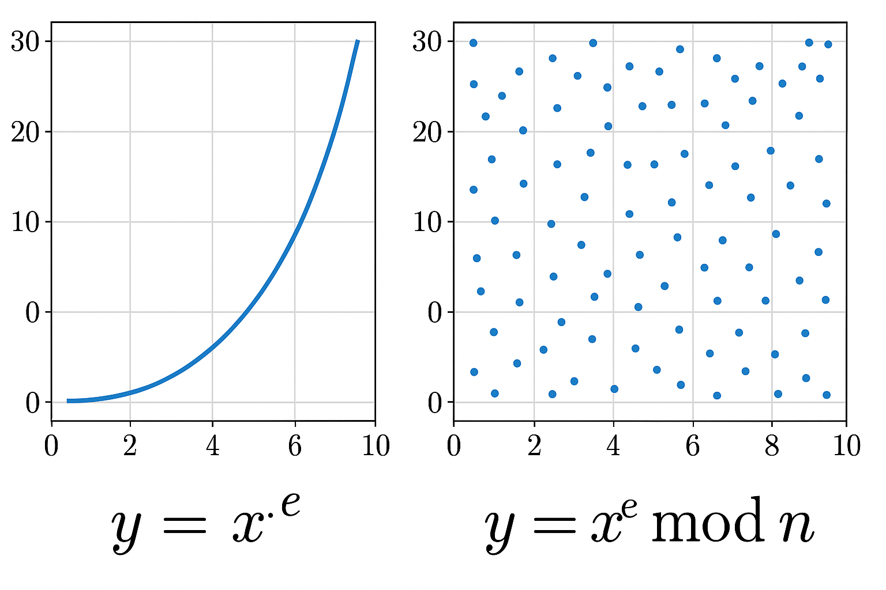

# zk-SNARKS Under the Hood - How They Work

In this post, I'll take you on a journey to demystify zk-SNARKs – one of the
most fascinating cryptographic innovations powering privacy and scalability in
the blockchain ecosystem. As someone deeply interested in this technology
myself, I want to share what I've learned about how these
"zero-knowledge proofs" actually work beneath the surface.

## Table of contents

1. [What is a zk-SNARK](#what-is-a-zk-snark)
    1. [Real-World Applications](#real-world-applications)
    2. [The Players: Prover and Verifier](#the-players)
    3. [The Three Essential Properties](#the-three-essential-properties)
    4. [Polynomial Equations recap](#polynomial-equations-recap)
2. [Non-Interactive Zero-Knowledge of a Polynomial](#non-interactive-zero-knowledge-of-a-polynomial)
    1. [Proving Knowledge of a Polynomial](#proving-knowledge-of-a-polynomial)
    2. [What does it mean to know a polynomial?](#what-does-it-mean-to-know-a-polynomial)
    3. [Homomorphic Encryption](#homomorphic-encryption)
        1. [Simple Homomorphic Encryption Scheme](#simple-homomorphic-encryption-scheme)
        2. [Modular Arithmetic Refresher](#modular-arithmetic-refresher)
        3. [Homomorphic Encryption with Modular Arithmetic](#homomorphic-encryption-with-modular-arithmetic)
        4. [Encrypted polynomials](#encrypted-polynomials)
    4. [Enforcing Polynomial Degree](#enforcing-polynomial-degree)
        1. [Degree Bound Enforcement via the Knowledge of Exponent Assumption](#degree-bound-enforcement-via-the-knowledge-of-exponent-assumption)
        2. [The Knowledge of Exponent Assumption (KEA)](#the-knowledge-of-exponent-assumption-kea)
        3. [Integrating KEA into Our Protocol](#integrating-kea-into-our-protocol)
        4. [The Small-Range Problem](#the-small-range-problem)
        5. [Zero‑knowledge](#zero-knowledge)
        6. [The Scaling Problem](#the-scaling-problem)
        7. [Multiplication of Encrypted Values - Cryptographic Pairings](#multiplication-of-encrypted-values---cryptographic-pairings)
        8. [Trusted Party Setup](#trusted-party-setup)
        9. [Trusting One out of Many](#trusting-one-out-of-many)
            1. [The Single-Trusted-Party Problem](#the-single-trusted-party-problem)
            2. [How the Ceremony Works](#how-the-ceremony-works)
            3. [Worked Example: Three-Party Ceremony](#worked-example-two-party-ceremony)
            4. [Verifying Each Contribution](#verifying-each-contribution)
            5. [The 1-of-n Trust Model](#the-1-of-n-trust-model)
            6. [Real-World Ceremonies](#real-world-ceremonies)
            7. [Remaining Limitation: Circuit-Specific Setup](#remaining-limitation-circuit-specific-setup)
        9. [Summary](#summary)
3. [Succinct Non-Interactive Argument of Knowledge of Polynomial](#succinct-non-interactive-argument-of-knowledge-of-polynomial)
    1. [Setup](#setup)
    2. [Proving](#proving)
    3. [Verification](#verification)
    4. [Conclusions](#conclusions)


## What is a zk-SNARK?<a name="what-is-a-zk-snark"></a>

zk-SNARK stands for **Z**ero-**K**nowledge **S**uccinct **N**on-interactive **AR**gument of **K**nowledge. That's quite a mouthful, so let's break it down:

* Zero-Knowledge: Proves knowledge of information without revealing the information itself
* Succinct: Proofs are small and quick to verify
* Non-interactive: No back-and-forth communication needed after initial setup
* Argument of Knowledge: Cryptographically secure proof that the prover possesses specific information

At its core, a zk-SNARK allows Alice to prove to Bob that she knows a secret value without telling Bob what that value is. Bob can verify the proof's validity with mathematical certainty.

## Real-World Applications<a name="real-world-applications"></a>
Before diving into the technical details, let's explore some concrete examples of what zk-SNARKs enable:

* Private Transactions: Prove you sent a valid payment without revealing the amount or recipient
* Identity Verification: Prove you're over 21 without showing your actual birthdate
* Tax Compliance: Prove you paid sufficient taxes without exposing your entire financial history
* Supply Chain: Verify ethical sourcing without revealing proprietary supplier information
* Voting Systems: Prove your vote was counted without revealing who you voted for

## The Players: Prover and Verifier<a name="the-players"></a>
The zk-SNARK protocol involves two primary participants:

* The Prover: Has some secret information and wants to convince others of a statement about that information
* The Verifier: Wants to confirm the statement is true without learning the secret information

For example, imagine the Prover wants to demonstrate: "I have more than 10,000 Euros in
my bank account" without revealing the exact balance.
The zk-SNARK allows the Verifier to be mathematically convinced of
this statement's truth without seeing any bank details.

## The Three Essential Properties<a name="the-three-essential-properties"></a>
For a zk-SNARK protocol to be valid and useful, it must satisfy three critical properties:

1. **Completeness**: If the statement is true and the Prover follows the protocol honestly, the Verifier will be convinced with overwhelming probability.
2. **Soundness**: If the statement is false, no dishonest Prover can trick the Verifier into accepting the proof, except with negligible probability.
3. **Zero-Knowledge**: The Verifier learns absolutely nothing about the underlying secret information beyond the validity of the statement being proven.

## Polynomial Equations recap<a name="polynomial-equations-recap"></a>

I am sure that most of you learned about polynomial equations in school. Since polynomials form the mathematical backbone of many cryptographic systems, let's recap some of their key properties:

* The **degree** of a polynomial is determined by its greatest exponent, in case for $f(x)$, then the exponent of $x$. For example: $f(x) = x^3 - 6*x^2 + 11*x - 6 $ -> greatest exponent is $3$, so the degree of the polynomial is $3$.
* Two **distinct** polynomials of degree most $d$ can intersect at no more than $d$ points (intersection $f(x) = g(x)$).

If a prover claims to know a polynomial, the verifier can easily verify that the prover indeed knows it, by

1. Choosing a random value for $x$ and calculating $f(x)$ locally
2. Asking the prover to calculate $f(x)$ for the same value of $x$ and return the result
3. Verify that local calculation matches the prover's result.

We might ask ourselves: what are the chances that the prover could cheat by "accidentally" providing the correct value of $f(x)$ without actually knowing the polynomial?

The answer is: the probability is negligibly small.

Consider a field with range for x from $1$ to $10^{77}$. If the prover knows a different polynomial $g(x)$ of the same degree, then $f(x)$ and $g(x)$
can agree in at most $d$ points (where $d$ is the degree). Therefore, the number of points where evaluations differ is at least $10^{77} - d$.
The probability that a randomly chosen $x$ accidentally "hits" any of the $d$ shared points is at most $d / 10^{77}$, which is negligible for practical values of $d$.

The number of points where evaluations are different is $10^{77} - d$ (where $d$ number of intersections).
Henceforth the probability that $x$ accidentally 'hits' any of the $d$ shared points is equal to $d / 10^{77}$, which is negligible.

This polynomial verification protocol:

* Requires only 1 round of communication
* Provides overwhelming probability of detecting a cheating prover
* Serves as a foundational building block for zk-SNARKs

This polynomial commitment and verification technique is one of the reasons why polynomials are at the core of zk-SNARKs and many other cryptographic protocols.

# Non-Interactive Zero-Knowledge of a Polynomial<a name="non-interactive-zero-knowledge-of-a-polynomial"></a>

## Proving Knowledge of a Polynomial<a name="proving-knowledge-of-a-polynomial"></a>

In the previous section we introduced a protocol, which allows a prover to prove
knowledge of a polynomial. But it is important to note that the protocol is based
on a weak notion of proof, since the protocol does not enforce the prover to know
a polynomial. The prover can use any means available to him to come up with a correct result.
Another problem is if the possible range of values for the polynomial is small, the
prover can simply guess the polynomial and the probability that it is going to be
accepted is non-negligible anymore, which is not good.

Therefore, will we have to address those issues. But before that, let's take a look at
what it actually means to know a polynomial.

## What does it mean to know a polynomial?<a name="what-does-it-mean-to-know-a-polynomial"></a>

Most of the time you will see polynomials expressed in the form of:
$$
c_n*x^n + ... + c_1*x^1 + c_0*x^0
$$
where $c_n$ is the coefficient of the polynomial, $x$ is the variable, and $n$ is the degree of the polynomial.
If someone claims to know a polynomial, what they really know is the coefficients of the polynomial.

For example if a prover claims to know a polynomial of degree 3, such that $x = 1$ and $x = 2$ 
they could know
$$x^3 − 3*x^2 + 2*x = 0
$$. For $x = 1$ we get $1 − 9 + 2 = 0$ and for $x = 2$ we get $8 − 12 + 4 = 0$.

You might be wondering how we got the mentioned polynomial for $x = 1$ and $x = 2$: factorization.

The Fundamental Theorem of Algebra states that any polynomial can be factored into linear polynomials (a degree 1 polynomials representing a line), as long it is solvable.
Which means that we can express any valid polynomial as a product of its factors:

$$
(x - a_0) * (x - a_1) * ... * (x - a_n) = 0
$$

In the case where the prover might know $$x^3 − 3*x^2 + 2*x = 0$$, we assume that the third solution is $x = 0$:
$$
(x - 1) * (x - 2) * (x - 0) = 0
=> x^3 - 3x^2 + 2x = 0
$$

Coming back to our example where a prover claims to know a polynomial of degree 3, such that $x = 1$ and $x = 2$, we can express it as:

$$
(x - 1) * (x - 2) * (x - a_0) = 0
$$

Where $a_0$ is the third root of the polynomial.

Now, if a prover wants to prove that he knows a polynomial of degree 3, such that $x = 1$ and $x = 2$
without disclosing the polynomial itself, he needs to prove that his polynomial is the multiplication of
the cofactors $t(x) = (x - 1)(x - 2)$ and some arbitrary polynomial $h(x)$, i.e.:
$$
p(x) = t(x) * h(x)
$$

Where $h(x)$ is equal to $x - 0$ in our example.

How does the prover prover that he knows the $p(x)$ polynomial without disclosing it?

By division without a remainder:
$$
h(x) + r(x) = \frac{p(x)}{t(x)}
$$
where $r(x) = 0$ since the requirement is 'division without a remainder'.

In our example
$$
h(x) = \frac{(x^3 - 3x^2 + 2x)}{((x - 1)(x - 2))}
$$
$$
h(x) = x 
$$
and the remainder is $0$.

The prover can prove that he knows the polynomial $p(x)$ by proving that the division of $p(x)$ by $t(x)$ has no remainder.

Putting this together into a protocol:

1. Verifier samples a random value $r$, calculates $t = t(r)$ and gives $r$ to the prover
2. Prover calculates $h(x) = p(x) / t(x)$ and evaluates $p(r)$ and $h(r)$; the resulting values $p$, $h$ are provided to the verifier
3. Verifier checks that $p(r) = t(r) * h(r)$ and accepts the proof if the equality holds

Let's see how this protocol works with $p(x) = x^3 − 3x^2 + 2x$ and  $t(x) = (x - 1)(x - 2)$.

1. Verifier samples r random value $23$, calculates $t = t(23) = (23 - 1)(23 - 2) = 462$ and gives $r = 23$ to the prover
2. Prover calculates $h(x) = p(x) / t(x) = x$, evaluates $p = p(23) = 10626$ and $h = h(23) = 23$ and provide $p, h$ to the verifier
3. Verifier then checks that $p = t * h: 10626 = 462 * 23$, which is true, so the verifier accepts the proof.

If the prover uses a different polynomial $p'(x) = 2x^3 - 3x^2 + 2x$, then 
the prover gets $h(x) = p'(x) / t(x) = 2x + 3 + 7x - 6$, were $7x - 6$ is the remainder of the division
$p(x) / t(x)$. Since

$$
\begin{aligned}
p(x) &= t(x) * h(x) + r(x)\ (\because r(x) \neq 0)\\
p(x) &= t(x) * h(x) + r(x) \\
\frac{p(x)}{t(x)} &= h(x) + \frac{r(x)}{t(x)} \\
\frac{p(x)}{t(x)} - \frac{r(x)}{t(x)} &= h(x) \\
h(x) &= \frac{p(x)}{t(x)} - \frac{r(x)}{t(x)} \\
h(x) &= 2x + 3 + \frac{7x - 6}{t(x)} \\
\end{aligned}
$$
the prover will have to divide the remainder by $t(r)$ in order to evaluate $h(r)$.

Due to the random selection of $r$ by the verifier, there is a low probability that
the evaluation of the remainder will be evenly divisible by $t(x)$. To catch
the cases where it is not evenly divisible, the verifier will have to additionally
check that $p(r)$ and $h(r)$ are integers. In case they are not integers, the
verifier will reject the proof.

Example:
$$
h(23) = (2×23 + 3) + (7×23 - 6)/t(23) \\
h(23) = 49 + 155/462  \\
h(23) = 49 + 0.3355   \\
$$
$h(23)$ is not an integer, so the verifier rejects the proof.

But this puts a constraint on the allowed polynomials, since the coefficients of the polynomial
must be integers. If the coefficients are not integers, the verifier has no way of 
distinguishing a valid polynomial from an invalid one?

That's why we are going to introduce cryptographic primitives, where such
division does not exist. You will soon understand why.

### Remarks:

Now we (as verifier) can check a polynomial for specific properties without learning the polynomial itself,
so this already gives us some form of zero-knowledge and succinctness.

Nonetheless, there are multiple issues with this construction:

1.  Prover may not know the claimed polynomial $p(x)$ at all. He can calculate
$t = t(r)$, select a random number $h$ and set $p = t * h$, which will be accepted by the verifier
as valid, since the equation holds.
2. Because prover knows the random point $x = r$, he can construct any polynomial which has
one shared point at $r$ with $t(r) * h(r)$.
3. In the original statement, prover claims to know a polynomial of a particular degree. In
the current protocol there is no enforcement of degree. Hence prover can cheat by using a
polynomial of higher degree which also satisfies the cofactors check.

Let's dig a bit deeper why these even exist.

#### Issue 1: Prover may not know the claimed polynomial $p(x)$ at all

At the beginning of the section, we have the following statement:

> For example if a prover claims to know a polynomial of degree 3, such that `x = 1` and `x = 2`...

and

> The Fundamental Theorem of Algebra states that any polynomial can be factored into linear polynomials (a degree 1 polynomials representing a line), as long it is solvable.
> Which means that we can express any valid polynomial as a product of its factors:
>
> ```
> (x - a_0) * (x - a_1) * ... * (x - a_n) = 0
> ```

I guess it is rather easy to spot, that the prover can simply select any random $h$
and set $p(x) = t(x) * h(x)$.

#### Issue 2: Prover can construct any polynomial which has one shared point at $r$ with $t(r) * h(r)$

The prover can come up with a polynomial $p'(x)$, such that $p'(r) = t(r) * h(r)$ without knowing the polynomial $p(x)$.

After receiving the value $r$, the prover comes up with a polynomial $p'(x)$, calculates $p'(r)$, and then calculates $h'(r) = p'(r) / t(r)$. The prover then sends $p'(r)$ and $h'(r)$ to the verifier, which will accept the proof.

#### Issue 3: No enforcement of degree

There is no enforcement of degree in the protocol. The prover can use a polynomial of higher degree which also satisfies the cofactors check.
For example, if the prover claims to know a polynomial of degree 3, such that $x = 1$ and $x = 2$, he can use a polynomial of degree 4 or higher which also satisfies the cofactors check.
For example, the prover can use $p'(x) = (x - 1)(x - 2)(x - 3)(x - 4)$ which is of degree 4 and also satisfies the cofactors check.
The verifier has no way of knowing the degree of the polynomial used by the prover.

#### How do we address these issues?

To address these issues, we need to introduce cryptographic primitives. Issues 1 and Issue 2
are possible, because the values are presented in cleartext, prover knows $r$ and $t(r)$. To resolve
those issues, we are going to use a cryptographic primitive that allows us to perform calculations on hidden values,
namely homomorphic encryption.

Let's get to it.

## Homomorphic Encryption<a name="homomorphic-encryption"></a>

Homomorphic encryption allows to encrypt a value and perform operations on the encrypted value without revealing it.

We are going to introduce a simple homomorphic encryption scheme, which allows us to perform addition and multiplication on encrypted values.

### Simple Homomorphic Encryption Scheme<a name="simple-homomorphic-encryption-scheme"></a>

The general idea is that we choose a base natural number $g$, e.g. $g=5$ (the requirements for that number are out of scope for this post) and to encrypt a value $v$, we exponentiate $g$ to the power of $v$:

$$
Enc(v) = g^v
$$

If we would like to encrypt the value $v=3$, we would get:

$$
Enc(3) = 5^3 = 125
$$
125 is the encrypted value of $3$. If we want to multiply this encrypted value by $2$, we raise the encrypted value to the power of $2$:

$$
Enc(3)^2 = (5^3)^2 = 5^{3*2} = 5^6
$$

What does that mean: We just multiplied an unknown value (here $3$) by $2$, without decrypting it.

We can also perform addition, by through multiplication. Let's say we want to add $2$ to our secret value $3$:
$$
Enc(3) * Enc(2) = 5^3 * 5^2 = 5^{3+2} = 5^5
$$

And we can also do subtraction, by dividing the encrypted values:

$$
Enc(3) / Enc(2) = 5^3 / 5^2 = 5^{3+2} = 5^1
$$

One problem: The base $g=5$ is public and it is easy to brute-force small values. To address this, we are going to perform the exponentiation in a finite field using modular arithmetic. In case you forgot, we are going to give a brief refresher on modular arithmetic.

### Modular Arithmetic Refresher<a name="modular-arithmetic-refresher"></a>

Modular arithmetic is a system of arithmetic for integers, where numbers "wrap around" upon reaching a certain value, called the modulus.

For example, in modulo $7$ arithmetic, the numbers wrap around after reaching $7$. So, $7 \mod 7$ is $0$, $8 \mod 7$ is $1$, $9 \mod 7$ is $2$, $15 \mod 7$ is $1$, and so on.
It also works for negative numbers: $-1 \mod 7$ is $6$, $-2 \mod 7$ is $5$, etc.

We can perform addition, subtraction, and multiplication in modular arithmetic as follows:
* Addition: $(a + b) \mod m$
    * Example: $(5 + 4) \mod 7 = 2$ (since $9 \mod 7 = 2$)
* Subtraction: $(a - b) \mod m$
    * Example: $(5 - 4) \mod 7 = 1$ (since $1 \mod 7 = 1$)
* Multiplication: $(a * b) \mod m$
    * Example: $(5 * 4) \mod 7 = 6$ (since $20 \mod 7 = 6$)
* Exponentiation: $(a^b) \mod m$
    * Example: $(5^3) \mod 7 = 6$ (since $125 \mod 7 = 6$)

Were $a$ and $b$ are integers, and $m$ is the modulus.
It is important to note that the order of operations does not matter, e.g. we can perform addition before or after taking the modulus.

Why is modular arithmetic helpful in our case?

It turns out that if ew use modular arithmetic, having a result of an operation, it is non-trivial to go back to the original numbers because many different pairs of numbers can produce the same result when taken modulo `m`.

$$
\begin{aligned}
5 + 7 &\equiv 5 \ (\text{mod}\ 7)\\
3 * 4 &\equiv 5 \ (\text{mod}\ 7)\\
5 * 1 &\equiv 5 \ (\text{mod}\ 7)\\
\end{aligned}
$$

Without the modulus, it is easy to determine the original numbers from the result.

Let's see how this looks graphically for RSA encryption. RSA has the following formula for encryption and decryption:

$$
\begin{aligned}
\text{Encryption: } c &\equiv m^e \ (\text{mod}\ n)\\
\text{Decryption: } m &\equiv c^d \ (\text{mod}\ n)\\
\end{aligned}
$$

Where `m` is the plaintext message, `c` is the ciphertext, `e` is the public exponent, `d` is the private exponent, and `n` is the modulus.

But let's see how it would look like without the modulus:

$$
\begin{aligned}
\text{Encryption: } c &\equiv m^e \\
\text{Decryption: } m &\equiv c^d \\
\end{aligned}
$$

Here a graphical representation of RSA encryption without and with modulus:



On the left side you can see the smooth curve of the function `y = x^e` (encryption), and on the right side you can see the scatter plot of the function `y = x^e mod n` (encryption with modulus). The smooth curve illustrates the clear relationship between `x` and `y`, making it easy to determine the original value of `x` from `y`.

By adding the modulus, we get this "cloud of dots" on the right side, destroying the smoothness of the curve and making it difficult to determine the original value of `x` from `y`.

### Homomorphic Encryption with Modular Arithmetic<a name="homomorphic-encryption-with-modular-arithmetic"></a>

Let's revisit our simple homomorphic encryption scheme, but this time using modular arithmetic.

$$
Enc(v) = g^v \ (\text{mod}\ p)
$$

Here some examples of operations on encrypted values using modular arithmetic:

$$
\begin{aligned}
5^1 &= 5 \ (\text{mod}\ p) \\
5^2 &= 4 \ (\text{mod}\ p) \\
5^3 &= 6 \ (\text{mod}\ p) \\
5^5 &= 3 \ (\text{mod}\ p) \\
5^{11} &= 3 \ (\text{mod}\ p) \\
5^{17} &= 3 \ (\text{mod}\ p) \\
\end{aligned}
$$

As you can see we even used different exponents, but the results are the same. In fact, if the modulo is large enough, it becomes computationally infeasible to determine the original value from the encrypted value. And this "hard" problem is what is used in today's cryptographic schemes to provide security.

All the homomorphic properties we discussed earlier still hold, but now the operations are performed modulo `p`.

$$
\begin{aligned}
Encryption: 5^3 \ (\text{mod}\ 7) = 6 \\
Multiplication: (5^3)^2 = 5^{3*2} = 5^6 \ (\text{mod}\ 7) = 1 \\
Addition: (5^3 * 5^2) = 5^{3+2} = 5^5 \ (\text{mod}\ 7) = 3 \\
\end{aligned}
$$

Modular division is a bit more complex, as it requires the concept of modular inverses, which is out of scope for this post.

Side note: There are limitations to this homomorphic encryption scheme. While we can multiply an encrypted value by an unencrypted value, we cannot multiply two encrypted values together. This is because the result would not be in the form of $g^v$, which is required for decryption.

Here the proof:
$$
\begin{aligned}
Enc(a) &= g^a \ (\text{mod}\ p) \\
Enc(b) &= g^b \ (\text{mod}\ p) \\
Enc(a) * Enc(b) &= g^a * g^b = g^{a+b} = Enc(a+b) \not = Enc(a*b) \ (\text{mod}\ p) \\
\end{aligned}
$$

### Encrypted polynomials<a name="encrypted-polynomials"></a>

Next, that we have a homomorphic encryption scheme, we can use it to encrypt polynomials.

An encrypted polynomial is simply a polynomial where the coefficients are encrypted using our homomorphic encryption scheme.
Let's say we have the following polynomial:

$$
p(x) = x^3 - 3x^2 + 2x
$$

We learned already, that to know a polynomial means to know its coefficients, here $1$, $-3$, and $2$.
Because homomorphic encryption does not allow to exponentiate an encrypted value, we must be given encrypted values of powers of $x$ from $1$ to $3$: 

$$
Enc(x^1), Enc(x^2), Enc(x^3)
$$
so that we can evaluate the encrypted polynomial as follows:

$$
\begin{aligned}
E(x^3)^1 * E(x^2)^{-3} * E(x^1)^2 \\
(g^{x^3})^1 * (g^{x^2})^{-3} * (g^{x^1})^2 \\
g^{x^3} * g^{-3x^2} * g^{2x^1} \\
g^{x^3 - 3x^2 + 2x} \\
\end{aligned}
$$

The result of such operations is, we have an encrypted evaluation of our polynomial at some unknown `x`.

This is quite powerful mechanism. Let's update our polynomial knowledge proof protocol to use encrypted polynomials.

1. Verifier samples a random value $r$ which is secret
2. Verifier calculates encryptions of $r$ for all powers from $1$ to $d$: $Enc(r^1), Enc(r^2), ..., Enc(r^d)$ and sends them to the prover
3. Verifier evaluates unencrypted target polynomial with $r$: $t = t(r)$ (Verifier knows $p(x) = t(x) * h(x)$)
4. Verifier sends encrypted powers to the prover
5. Prover calculates polynomial $h(x) = p(x) / t(x)$
6. Prover evaluates $E(p(r))$ and $E(h(r))$ using encrypted powers received from the verifier
7. The resulting encrypted values $E(p(r))$, $E(h(r))$ are provided to the verifier
8. Verifier checks that $E(p(r)) = E(h(r))^{t(r)} = g^{t(r) * h(r)}$ and accepts the proof if the equality holds

Let's see how this protocol works with $p(x) = x^3 − 3x^2 + 2x$ and  $t(x) = (x - 1)(x - 2)$.

#### Setup
We know:

$$
\begin{aligned}
p(x) &= x^3 − 3x^2 + 2x \\
t(x) &= (x - 1)(x - 2) \\
h(x) &= \frac{p(x)}{t(x)} = x \\
\end{aligned}
$$

And we use: $g = 2$, $p = 101$
Therefore:

$$
Enc(v) = 2^v \ (\text{mod}\ 101) \\
$$

#### Protocol Execution
1. Verifier samples $s$ random value $7$
2. Verifier calculates encrypted powers:

    $$
    \begin{aligned}
    Enc(7^1) = 2^7 \ = 27 \ (\text{mod}\ 101) \\
    Enc(7^2) = 2^{49} \ = 50 \ (\text{mod}\ 101) \\
    Enc(7^3) = 2^{343} \ = 86 \ (\text{mod}\ 101) \\
    \end{aligned}
    $$

3. Verifier forwards encrypted powers to the prover
4. Prover calculates $h(x) = p(x) / t(x) = x$
5. Prover evaluates encrypted polynomial $p(x)$ at $s = 7$ (prover does not know $s$ in cleartext :!:):
    $$
    \begin{aligned}
    E(p(7)) & = E(7^3 - 3*7^2 + 2*7^1) \\
    & = E(7^3)^1 * E(7^2)^{-3} * E(7^1)^2 && \text{Prover received encrypted values } \\
    & = 86^1 * 50^{-3} * 27^2 \\
    & = 86 * 93 * 22 \\
    & = 14 \ (\text{mod}\ 101) \\
    \end{aligned}
    $$

    Do not forget that:

    $$
    \begin{aligned}
    E(a) * E(b) &= E(a + b) \ (\text{mod}\ p) \\
    E(a)^k &= E(k * a) \ (\text{mod}\ p) \\
    E(a)^{-1} &= E(-a) \ (\text{mod}\ p) \\
    \end{aligned}
    $$

6. Prover evaluates encrypted polynomial $h(x)$ at $s = 7$:

    $$
    \begin{aligned}
    E(h(7)) & = E(7) \\
    & = 27 \ (\text{mod}\ 101) \\
    \end{aligned}
    $$

7. Prover sends $E(p(7)) = 14$ and $E(h(7)) = 27$ to the verifier
8. Verifier calculates $t(7) = (7 - 1)(7 - 2) = 30$ and checks that:

    $$
    E(p(7)) \stackrel{?}{=} E(h(7))^{t(7)} = 27^{30} \equiv 14 \ (\text{mod}\ 101) \\
    $$

Since the equality holds, the verifier accepts the proof.

To explore the protocol’s limitations, let’s examine what happens when the prover attempts to cheat.

#### Cheating Prover Example

Setup remains the same, besides the prover using $p'(x)=t(x)*(x+5)$, which is divisible by
$t(x)$ (so it has a clean cofactor). Steps 1 to 3 are the same as before.

4. Cheating Prover uses $h'(x) = p'(x)/t(x) = x + 5$ instead of $h(x) = x$
5. Cheating Prover evaluates encrypted polynomial $p'(x) = x^3 + 2x^2 − 13x + 10$ at $r = 7$:

    $$
    \begin{aligned}
    Enc(p'(r))=Enc(r^3)^1 * Enc(r^2)^2 * Enc(r)^{-13} * Enc(1)^{10} \equiv 87 \ (\text{mod}\ 101) \\
    \end{aligned} 
    $$

6. Cheating Prover evaluates encrypted polynomial $h'(x)$ at $r = 7$:

    $$
    \begin{aligned}
    h'(s)= s + 5 = 7 + 5 = 12 \Rightarrow E(h'(s))=E(s) * Enc(1)^5=27 \cdot 2^{5}=27 \cdot 32 \equiv 56 \ (\text{mod}\ 101).
    \end{aligned}
    $$

7. Cheating Prover sends $E(p'(7)) = 87$ and $E(h'(7)) = 56$ to the verifier
8. Verifier calculates $t(7) = (7 - 1)(7 - 2) = 30$ and checks that:

    $$
    \begin{aligned}
    E(p'(7)) \stackrel{?}{=} E(h'(7))^{t(7)} (\text{mod}\ 101) \\
    87 \stackrel{?}{=} 56^{t(7)} (\text{mod}\ 101) \\
    87 \stackrel{?}{=} 56^{30} (\text{mod}\ 101) \\
    87 = 87 (\text{mod}\ 101)
    \end{aligned}
    $$

Since the equality does hold, the verifier accepts the proof.

That's the whole point of the cheat: with a single hidden point $s$, the prover can pick a different polynomial
$p'(x)$ (here still degree <= 3) that satisfies $p'(s) = t(s) * h'(s)$, where $h'(x)$ is the cofactor of $p'(x)$.
The check passes at that point, even though $p'(x) \neq p(x)$.

### Addressing the Issues

In the current protocol, we managed to address Issue 1 and Issue 2:
1. Prover may not know the claimed polynomial $p(x)$ at all
    * Now the prover cannot come up with any polynomial, since the verifier sends encrypted powers of a secret random value
2. Prover can construct any polynomial which has one shared point at $s$ with $t(s) * h(s)$
    * Now the prover cannot construct any polynomial, since the verifier sends encrypted powers of a secret random value

However, we still have Issue 3: No enforcement of degree.
3. No enforcement of degree 
    * We still have no enforcement of degree. The prover can use a polynomial of higher degree which also satisfies the cofactors check.

Wow, that was a lot of information to digest. In the next section, we will address Issue 3 and
complete our polynomial knowledge proof protocol.

Even with hidden evaluation points, our protocol still fails to restrict a prover's polynomial degree. The next step introduces a mechanism to enforce this constraint-bringing us closer to real-world zkSNARK structure, where degree bounds are crucial for soundness.

## Enforcing Polynomial Degree<a name="enforcing-polynomial-degree"></a>

Previously, we ensured that the prover couldn't fabricate arbitrary encrypted values or match a different polynomial at a single secret point.

However, we still had no guarantee on polynomial degree - a malicious prover could use higher-degree terms while remaining undetected.

To fix this, we need a way to prove that the prover’s encrypted computations used only the encryptions of powers of the verifier's secret value $s$.

### Degree‑Bound Enforcement via the Knowledge‑of‑Exponent Assumption<a name="degree-bound-enforcement-via-the-knowledge-of-exponent-assumption"></a>

Knowing a polynomial means knowing its coefficients. In our protocol, each coefficient corresponds to a power of the encrypted secret $s$. However, since the prover controls the exponentiation process, nothing prevents them from introducing extra terms unless we cryptographically bind every operation to the verifier's provided values.

This binding is achieved through the Knowledge‑of‑Exponent Assumption (KEA), introduced by Ivan Damgård in `Towards Practical Public Key Systems Secure Against Chosen Ciphertext Attacks`.

#### The Knowledge of Exponent Assumption (KEA)<a name="the-knowledge-of-exponent-assumption-kea"></a>

Let us understand first what KEA states before we integrate it into our protocol.

Knowledge of Exponent Assumption (KEA) is a cryptographic assumption that demonstrate the knowledge of an exponent in a given equation without revealing the exponent itself. KEA is often used in various cryptographic protocols to prove the possession of a private key without disclosing the private key itself.

In simple terms, if someone is given two group elements $g$ and $g^a$, and they later produce another pair $(X, Y)$ such that $Y = X^a$, KEA assumes they must actually know the number $x$ for which $X = g^x$.

They cannot simply "guess" or forge such matching values, producing a consistent pair implies knowledge of the hidden exponent.

##### Illustrative Example

To visualize how KEA works, consider a simple interaction between Alice and Bob:

Alice picks a random value $a$ that has to be exponentiated by Bob to any power, with the requirement that only $a$ can be exponentiated, and nothing else.

1. Alice samples a random value $\alpha$
2. Alice calculates $A = a^{\alpha} \mod n$
3. Send $(a, A)$ to Bob
4. Bob picks a random value $x$
5. Bob calculates $X = a^{x} \mod n$ and $Y = A^{x} \mod n$
6. Send $(X, Y)$ to Alice
7. Alice checks that $Y \stackrel{?}{=} X^{\alpha} \mod n$

If the equality holds, Alice is convinced that Bob knows $x$ such that $X = a^x \mod n$. Alice hasn't learned anything about $x$ itself, but she is convinced that Bob knows it. Bob also hasn't learned anything about $\alpha$ - if he would, we would be in trouble.

### Integrating KEA into Our Protocol<a name="integrating-kea-into-our-protocol"></a>


### Setup
We know:

$$
\begin{aligned}
p(x) &= x^3 − 3x^2 + 2x \\
\end{aligned}
$$

And we use: $g = 2$, $p = 101, \alpha = 5$
Therefore:

$$
Enc(v) = 2^v \ (\text{mod}\ 101) \\
$$

#### Protocol Execution
1. Verifier samples $s$ random value $7$
2. Verifier calculates encrypted powers (the number of powers is determined by the degree of the polynomial, here $3$):

    $$
    \begin{aligned}
    Enc(7^1) = 2^7 \ = 27 \ (\text{mod}\ 101) \\
    Enc(7^2) = 2^{49} \ = 50 \ (\text{mod}\ 101) \\
    Enc(7^3) = 2^{343} \ = 86 \ (\text{mod}\ 101) \\
    \end{aligned}
    $$

and to enforce polynomial soundness under KEA, the verifier calculates also:

$$
\begin{aligned}
Enc(7^1)^\alpha = (2^7)^\alpha \ = (2^7)^5 \ = 2^{35}\ \ = 51(\text{mod}\ 101) \\
Enc(7^2)^\alpha = (2^{49})^\alpha \ = (2^{49})^5 \ = 2^{245} \ = 76 \ (\text{mod}\ 101) \\
Enc(7^3)^\alpha = (2^{343})^\alpha \ = (2^{343})^5 \ = 2^{1715} \ = 37 \ (\text{mod}\ 101) \\
\end{aligned}
$$

3. Verifier forwards encrypted powers with and without the $\alpha$ shift to the prover
4. Prover evaluates encrypted polynomial $p(x)$ at $s = 7$ (prover does not know $s$ in cleartext :!:):
    $$
    \begin{aligned}
    E(p(7)) & = E(7^3 - 3*7^2 + 2*7^1) \\
    & = E(7^3)^1 * E(7^2)^{-3} * E(7^1)^2 && \text{Prover received encrypted values } \\
    & = 86^1 * 50^{-3} * 27^2 \\
    & = 86 * 93 * 22 \\
    & = 14 \ (\text{mod}\ 101) \\
    \end{aligned}
    $$

    and $\alpha*p(s)$:

    $$
    \begin{aligned}
    E(p(7))^{\alpha} & = E(7^3 - 3*7^2 + 2*7^1)^{\alpha} \\
    & = E(7^3)^{1*\alpha} * E(7^2)^{-3*\alpha} * E(7^1)^{2*\alpha} && \text{Prover received encrypted values } \\
    & = (E(7^3)^{\alpha})^1 * (E(7^2)^{\alpha})^{-3} * (E(7^1)^{\alpha})^{2} \\
    & = 37^1 * 76^{-3} * 51^2 \\
    & = 37 * 64 * 76 \\
    & = 87 \ (\text{mod}\ 101) \\
    \end{aligned}
    $$

7. Prover sends $E(p(7)) = 14$ and $E(p(7))^{\alpha} = 87$ to the verifier
8. Verifier checks $(g^p)^{\alpha} = E(p(7))^{\alpha}$
    $$
    \begin{aligned}
    (g^p)^{\alpha} \stackrel{?}{=} E(p(7))^{\alpha} (\text{mod}\ 101) \\
    (2^{p(s)})^{5} \stackrel{?}{=} 87 (\text{mod}\ 101) \\
    (2^{p(7)})^{5} \stackrel{?}{=} 87 (\text{mod}\ 101) \\
    (2^{p(7)})^{5} \stackrel{?}{=} 87 (\text{mod}\ 101) \\
    (2^{210})^{5} \stackrel{?}{=} 87 (\text{mod}\ 101) \\
    2^{1050} \stackrel{?}{=} 87 (\text{mod}\ 101) \\
    87 = 87 (\text{mod}\ 101
    \end{aligned}
    $$

With the added KEA check, we can be sure that the prover used only the provided polynomial by the verifier, and did not introduce any higher-degree terms, since there is no other way to preserve the $\alpha$-shifted relationship without knowing the exponents used.

#### The small-range problem<a name="the-small-range-problem"></a>

At this stage, our protocol works exactly as intended: the prover and verifier can both compute

$$(g^{p(7)})^{\alpha} = E(p(7))^{\alpha} \pmod{101},$$

so the verifier is convinced that the prover knows the correct polynomial evaluation, without seeing the actual polynomial.
That sounds like a zero‑knowledge proof, since nothing about the coefficients $c_i$ was revealed directly.
But there's a subtle weakness hiding here.

Zero-knowledge means the verifier should learn nothing about the hidden data, no matter what.

However, in this simplified modular example, our coefficients don't live in a huge space, they take on small, easily enumerable values (for instance, between 0 and 100).

That small range opens the door for brute‑force attacks.

If the verifier knows the structure of the polynomial (say, $p(x)=c_2x^2 + c_1x + c_0$) and the evaluation point $x=7$, then they can simply try every possible combination of coefficients until their computed $E(p(7))$ matches the prover's.

Even if each coefficient can take 100 values, a degree‑2 polynomial gives

$100^3 = 1 000 000$ possible combinations, something that a single modern computer can test in seconds.

#### Zero-knowledge <a name="zero-knowledge"></a>
Up to this point, the protocol proves soundness:

the verifier is convinced that the prover evaluated exactly the intended polynomial, not one of higher degree, and did so correctly at the hidden point $s$.
However, soundness $\neq$ zero‑knowledge.

Zero-knowledge adds a second promise: that the verifier learns nothing else about the prover's secret polynomial.

In our example protocol from [Integrating KEA into Our Protocol](#integrating-kea-into-our-protocol), the prover send the verifier the encrypted evaluation $E(p(7))$.

At first glance, that seems safe: the verifier only sees an encrypted value, not the polynomial itself.

However, because our encryption is weak (due to the small coefficient range) and being deterministic, the verifier can exploit it to learn something about the polynomial.

Deterministic encryption means that the same input always produces the same output ($E(m) = E(m)$).

If the verifier ever sees that same number for $E(p(7))$ again, the verifier can recognize it and infer, "oh, this is the same value as before."

That tiny bit of leakage breaks the "learn nothing" guarantee - it lets the verifier correlate runs and gain information about the prover's secret polynomial.

How can we fix this?

Based on what we've learned in the [The Knowledge of Exponent Assumption (KEA)](#the-knowledge-of-exponent-assumption-kea) we are going to introduce randomness to step 7 of the protocol execution. The prover will blind the encrypted polynomial evaluation with a random value.

5. Prover picks a random value $\delta$, calculates $E(p(7))^{\delta}$ and $E(p(7))^{\alpha \delta}$ and sends it to the verifier
6. Verifier checks $(g^{p(7)})^{\alpha \delta} = (E(p(7))^{\alpha})^{\delta}$

We see that now the verifier cannot correlate runs based on the encrypted polynomial evaluation, since it is blinded with a random value $\delta$.

And now the protocol is truly zero-knowledge: the verifier learns nothing about the prover's secret polynomial, beyond the fact that it was evaluated correctly at the hidden point $s$.

#### The scaling problem<a name="the-scaling-problem"></a>

Up to this point, our protocol has achieved Soundness (the Prover can't lie) and Zero-Knowledge (the Verifier doesn't learn the secret). But we have an **interactive** zero-knowledge protocol. You can compare an interactive protocol it with a private conversation between two parties, the Prover and the Verifier.

Why is it interactive?

Because the verifier picks the secrets $s$ and $\alpha$, hides them, and then challenges the Prover.

Now, if a third party joins and sees the result of the interaction, they cannot trust it. The third party does not know if the Prover and Verifier might have colluded.

Therefore, the third party would need to run the protocol with the Prover themselves, by picking their own secrets $s'$ and $\alpha'$. What if 1000 more parties want to verify the proof? They would all need to run the protocol with the Prover, which is not scalable.

Imagine this in the context of a blockchain, such as Ethereum, with millions of users. If every user needs to interact with the Prover to verify a proof, it would be impossible to scale.

Therefore, our goal is a non-interactive protocol where a single proof can be verified by anyone, anywhere, at any time. This requires us to transform the secret parameters $s$ and $\alpha$ into a public reference that is simultaneously accessible to all, but remains infeasible for anyone to exploit.

We could achieve this by encrypting the secrets $s$ and $\alpha$ the same way the verifier encrypts the powers of $s$ before sending them to the Prover. However, the homomorphic encryption we use does not support the multiplication of two encrypted values, which is required for both verification checks to multiply encryptions of $t(s)$ and $h$ as well as $p$ and $\alpha$.

This is where we will have to introduce a new cryptographic primitive called Cryptographic Pairings.

---
**Interactive vs Non-Interactive Zero-Knowledge Proofs**

In an interactive zero-knowledge proof, the Prover and Verifier engage in a back-and-forth communication. The Verifier is actively involved in the proof process. The Prover responds to the Verifier's challenges, and the Verifier checks the responses to determine if the proof is valid.

In contrast, a non-interactive zero-knowledge proof does not require an interaction between the Prover and Verifier. The Prover generates a proof that can be verified by anyone without needing to communicate with the Prover. This is typically achieved using a Common Reference String (CRS) that both parties can access.

How it usually works:

1. We have a Trusted Setup ceremony creates the encrypted secrets ($s$ and $\alpha$) and publishes them on a public notice board. The original "raw" secrets are then destroyed (the "Toxic Waste").
2. Anyone can walk up to the notice board, see the Prover's proof, and use the public tools to verify it themselves. They don't need to talk to the Prover at all.
3. Because the Verifier no longer knows the secret $\alpha$ (it was destroyed), they need a special mathematical "lens"-Cryptographic Pairings (later more)-to check if the Prover’s math is correct using only the public, encrypted data.

---

#### Multiplication of Encrypted Values - Cryptographic Pairings<a name="multiplication-of-encrypted-values---cryptographic-pairings"></a>

A cryptographic pairing, also called a bilinear map, is a mathematical function that takes two group elements as input and returns an element in a third group.
Informally, if we encode two values $a$ and $b$ as group elements
$$g^a$$
and
$$h^b$$
then a pairing allows us to obtain an encoding of their product:

$$e(g^a, h^b) = e(g,h)^{ab}$$

The values $a$ and $b$ are not revealed directly. Instead, they remain hidden in the exponents. However, the pairing makes it possible to verify a multiplicative relationship between them.

More formally, a pairing is a function

$$e : G_1 \times G_2 \rightarrow G_T$$

where $G_1$, $G_2$, and $G_T$ are groups. The crucial property is bilinearity:

$$e(g^a, h^b) = e(g,h)^{ab}$$

This means that exponentiation in the input groups becomes multiplication in the exponent of the output group.
For example, suppose a prover claims that three hidden values satisfy

$$c = ab$$

The verifier can check this relation using pairings:

$$e(g^a, h^b) \stackrel{?}{=} e(g^c, h)$$

The left-hand side is

$$e(g^a, h^b) = e(g,h)^{ab}$$

and the right-hand side is

$$e(g^c, h) = e(g,h)^c$$

Therefore, the equality holds exactly when

$$c = ab$$

assuming the encodings were constructed correctly.

This ability is important because ordinary group operations naturally support addition of encoded values. For example:

$$g^a \cdot g^b = g^{a+b}$$

But ordinary group operations do not allow us to directly obtain

$$g^{ab}$$

from $g^a$ and $g^b$. Pairings provide this missing multiplicative check.

However, the result of a pairing lives in the target group $G_T$, not in the original input groups $G_1$ or $G_2$. Therefore, the output of one pairing cannot generally be used as the input to another pairing:

$$e : G_1 \times G_2 \rightarrow G_T$$

not

$$e : G_T \times G_1 \rightarrow G_T$$

This is an important limitation. A pairing can combine two encoded values multiplicatively, but it does not allow unlimited repeated multiplication inside the same structure. For instance, from

$$e(g^a, h^b) = e(g,h)^{ab}$$

we do not obtain a new $G_1$ or $G_2$ element that can be paired again with $g^c$ to produce an encoding of $abc$.
In this sense, pairings allow a controlled form of multiplication: they let us verify products of encoded values, but they do not allow arbitrary chained multiplication.
Pairing outputs also preserve a homomorphic-like structure inside the target group. For example:

$$e(g^a, h^b) \cdot e(g^c, h^d)
=
e(g,h)^{ab} \cdot e(g,h)^{cd}$$

which gives

$$e(g,h)^{ab + cd}$$

So pairings can be used not only to check individual products, but also sums of products. This is exactly the kind of algebraic structure needed in SNARKs, where computations are represented as arithmetic constraints involving additions and multiplications.

#### Trusted Party Setup <a name="trusted-party-setup"></a>

During the Trusted Setup, a trusted party samples the secret values, such as $s$ and $\alpha$, and encodes all necessary powers of $s$ together with their corresponding $\alpha$-shifts:

$$
g^\alpha,\quad g^{s^i},\quad g^{\alpha s^i}
$$

for

$$
i = 0, 1, \dots, d
$$

where $d$ is the maximum degree of the polynomials used by the protocol.

Once these encoded values are computed, the trusted party must destroy the original raw secrets $s$ and $\alpha$. These raw values are often called the ☣️ **toxic waste** ☣️. If someone keeps them, they could create fake proofs that still pass verification.

The published encoded values form the **Common Reference String**, or **CRS**. The CRS is public and reusable: after it has been generated, any Prover can use it to create a proof, and any Verifier can use it to check that proof without interacting with the Prover.

The CRS is usually divided into two parts:

1. The **Proving Key**, used by the Prover to construct proofs.
2. The **Verification Key**, used by the Verifier to check proofs.

In our simplified setting, the Proving Key contains the encoded powers of $s$ and their $\alpha$-shifted versions:

$$
\text{Proving Key} = \left( g^{s^i},\ g^{\alpha s^i} \right)
\quad \text{for } i = 0,1,\dots,d
$$

The Verification Key contains the values needed by the Verifier:

$$
\text{Verification Key} = \left( g^{t(s)},\ g^\alpha \right)
$$

Here, $t(x)$ is the target polynomial, and $g^{t(s)}$ is the encoded evaluation of the target polynomial at the secret point $s$.

Now the important point is that the Verifier can perform the necessary checks without knowing $s$ or $\alpha$.

The Prover uses the Proving Key to compute encoded polynomial evaluations such as:

$$
g^{p(s)},\quad g^{h(s)},\quad g^{p'(s)}
$$

where $p'(s)$ is the $\alpha$-shifted version of $p(s)$:

$$
p'(s) = \alpha p(s)
$$

However, to preserve zero-knowledge, the Prover should not send these values directly. If the Prover always sent

$$
g^{p(s)},\quad g^{h(s)},\quad g^{\alpha p(s)}
$$

then the proof would be deterministic. Anyone seeing the same proof values again could recognize that the same hidden polynomial evaluation was used.

To prevent this, the Prover samples a fresh random blinding factor

$$
\delta \neq 0
$$

for every proof and sends the blinded values instead:

$$
g^{\delta p(s)},\quad g^{\delta h(s)},\quad g^{\delta \alpha p(s)}
$$

The blinding factor changes the concrete group elements, but it preserves the algebraic relationships that the Verifier needs to check.

The Verifier then uses pairings to check the proof.

First, the Verifier checks that $p(x)$ is divisible by the target polynomial $t(x)$.

Recall that the Prover wants to convince the Verifier that:

$$
p(x) = t(x)h(x)
$$

At the hidden point $s$, this becomes:

$$
p(s) = t(s)h(s)
$$

Because the Verifier only has encoded values, they cannot directly multiply $g^{t(s)}$ and $g^{h(s)}$ to obtain $g^{t(s)h(s)}$. But with pairings, they can check the multiplicative relation:

$$
e(g^{\delta p(s)}, g) \stackrel{?}{=} e(g^{t(s)}, g^{\delta h(s)})
$$

The left-hand side is:

$$
e(g^{\delta p(s)}, g) = e(g,g)^{\delta p(s)}
$$

The right-hand side is:

$$
e(g^{t(s)}, g^{\delta h(s)}) = e(g,g)^{\delta t(s)h(s)}
$$

Therefore, the equality holds when:

$$
p(s)=t(s)h(s)
$$

Second, the Verifier checks that the Prover constructed $p(s)$ correctly using the powers published in the CRS.

This is where the secret $\alpha$ is used. During setup, the CRS included both:

$$
g^{s^i}
$$

and

$$
g^{\alpha s^i}
$$

So if the Prover honestly computes:

$$
g^{p(s)}
$$

then they should also be able to compute the matching shifted value:

$$
g^{p'(s)} = g^{\alpha p(s)}
$$

The Verifier checks this with another pairing equation:

$$
e(g^{\delta p(s)}, g^\alpha) \stackrel{?}{=} e(g^{\delta \alpha p(s)}, g)
$$

The left-hand side is:

$$
e(g^{\delta p(s)}, g^\alpha)=e(g,g)^{\delta \alpha p(s)}
$$

The right-hand side is:

$$
e(g^{\delta \alpha p(s)}, g)=e(g,g)^{\delta \alpha p(s)}
$$

So the equality holds when the Prover's shifted value is consistent with the blinded polynomial evaluation.

This check prevents the Prover from submitting arbitrary encoded values. They must submit values that are consistent with the structured powers generated during the Trusted Setup.

Together, these two pairing checks replace the role of the interactive Verifier.

Previously, the Verifier personally chose $s$ and $\alpha$, kept them secret, and used them to challenge the Prover. Now, the Trusted Setup publishes only encoded versions of those secrets. Pairings allow anyone to verify the same relationships using the public CRS, without learning the secrets themselves.

This is what makes the protocol non-interactive: the Prover can generate a proof once, publish it, and anyone can verify it independently.

##### Example: Trusted Setup with Our Polynomial

Let us continue with the same polynomial from before:

$$
p(x)=x^3-3x^2+2x
$$

and the same target polynomial:

$$
t(x)=(x-1)(x-2)
$$

Since

$$
p(x)=t(x)h(x)
$$

we have:

$$
h(x)=x
$$

Assume the Trusted Setup samples the secret values:

$$
s=7
$$

and

$$
\alpha=5
$$

In a real protocol, these values would be sampled randomly from a very large field. Here we use small numbers only for illustration.

The trusted party now computes the encoded powers of $s$ up to degree $3$:

$$
g^{s^0}=g^1
$$

$$
g^{s^1}=g^7
$$

$$
g^{s^2}=g^{49}
$$

$$
g^{s^3}=g^{343}
$$

It also computes the corresponding $\alpha$-shifted powers:

$$
g^{\alpha s^0}=g^5
$$

$$
g^{\alpha s^1}=g^{35}
$$

$$
g^{\alpha s^2}=g^{245}
$$

$$
g^{\alpha s^3}=g^{1715}
$$

These values become part of the Proving Key.

The trusted party also computes the value needed for verification:

$$
t(s)=t(7)=(7-1)(7-2)=30
$$

so the Verification Key contains:

$$
g^{t(s)}=g^{30}
$$

and

$$
g^\alpha=g^5
$$

After publishing these encoded values, the trusted party must delete the raw secrets $s=7$ and $\alpha=5$.

Now the Prover uses the Proving Key to compute the encoded evaluation of $p(s)$.

Since

$$
p(7)=7^3-3\cdot 7^2+2\cdot 7
$$

we get:

$$
p(7)=343-147+14=210
$$

Internally, the Prover first computes:

$$
g^{p(s)}=g^{210}
$$

The Prover also computes the quotient polynomial evaluation:

$$
h(7)=7
$$

so internally they compute:

$$
g^{h(s)}=g^7
$$

Finally, using the $\alpha$-shifted powers from the Proving Key, the Prover computes:

$$
g^{p'(s)}=g^{\alpha p(s)}
$$

Since $\alpha=5$ and $p(7)=210$, this becomes:

$$
g^{p'(s)}=g^{5\cdot 210}=g^{1050}
$$

These are the unblinded values. However, to preserve zero-knowledge, the Prover should not send them directly.

If the Prover always sent

$$
g^{p(s)},\quad g^{h(s)},\quad g^{\alpha p(s)}
$$

then the proof would be deterministic. Anyone seeing the same values again could recognize that the same hidden polynomial evaluation was used.

To prevent this, the Prover samples a fresh random blinding factor. For this example, let:

$$
\delta = 3
$$

In a real protocol, $\delta$ would be sampled randomly from a very large field and would be different for every proof.

The Prover now blinds the values by raising them to the power of $\delta$.

Instead of sending:

$$
g^{p(s)} = g^{210}
$$

the Prover sends:

$$
(g^{p(s)})^\delta = g^{\delta p(s)} = g^{3 \cdot 210}=g^{630}
$$

Instead of sending:

$$
g^{h(s)} = g^7
$$

the Prover sends:

$$
(g^{h(s)})^\delta = g^{\delta h(s)} = g^{3 \cdot 7}=g^{21}
$$

And instead of sending:

$$
g^{\alpha p(s)} = g^{1050}
$$

the Prover sends:

$$
(g^{\alpha p(s)})^\delta = g^{\delta \alpha p(s)}
$$

Since $\delta=3$, $\alpha=5$, and $p(7)=210$, this becomes:

$$
g^{\delta \alpha p(s)} = g^{3 \cdot 5 \cdot 210}=g^{3150}
$$

The Verifier now receives the blinded proof values:

$$
g^{\delta p(s)}=g^{630}
$$

$$
g^{\delta h(s)}=g^{21}
$$

$$
g^{\delta \alpha p(s)}=g^{3150}
$$

and uses the Verification Key:

$$
g^{t(s)}=g^{30}
$$

$$
g^\alpha=g^5
$$

The first check verifies divisibility:

$$
e(g^{\delta p(s)}, g) \stackrel{?}{=} e(g^{t(s)}, g^{\delta h(s)})
$$

Substituting the values:

$$
e(g^{630}, g) \stackrel{?}{=} e(g^{30}, g^{21})
$$

The left-hand side is:

$$
e(g^{630}, g)=e(g,g)^{630}
$$

The right-hand side is:

$$
e(g^{30}, g^{21})=e(g,g)^{30\cdot 21}=e(g,g)^{630}
$$

So the first check passes.

The second check verifies that the Prover used the structured powers from the CRS correctly:

$$
e(g^{\delta p(s)}, g^\alpha) \stackrel{?}{=} e(g^{\delta \alpha p(s)}, g)
$$

Substituting the values:

$$
e(g^{630}, g^5) \stackrel{?}{=} e(g^{3150}, g)
$$

The left-hand side is:

$$
e(g^{630}, g^5)=e(g,g)^{630\cdot 5}=e(g,g)^{3150}
$$

The right-hand side is:

$$
e(g^{3150}, g)=e(g,g)^{3150}
$$

So the second check also passes.

This example shows why pairings are the missing ingredient.

The Verifier does not know $s$, does not know $\alpha$, does not know $p(s)$, does not know $h(s)$, and does not know the blinding factor $\delta$. Nevertheless, using only the public CRS and the Prover's blinded encoded outputs, the Verifier can check that:

$$
p(s)=t(s)h(s)
$$

and that the Prover's polynomial evaluation was constructed consistently from the powers published during the Trusted Setup.

The fresh blinding factor makes the proof non-linkable: even if the Prover proves the same statement again, a new $\delta$ produces different group elements while preserving the same pairing equations.

That is the core idea behind turning our interactive polynomial protocol into a non-interactive zero-knowledge protocol.

#### Trusting One out of Many<a name="trusting-one-out-of-many"></a>

##### The Single-Trusted-Party Problem<a name="the-single-trusted-party-problem"></a>

Recall what the Trusted Setup produces: a Common Reference String (CRS) that encodes powers of a secret value $s$ and a secret shift $\alpha$. If the party who runs the setup keeps those raw values, they can:

1. Compute any polynomial evaluation at $s$ from scratch.
2. Construct a fake proof for a false statement that passes both pairing checks perfectly.

This is sometimes called the **toxic-waste problem**: the raw secrets must be destroyed after the ceremony, but there is no way for an outsider to verify that destruction actually happened. A malicious or compromised single party is an undetectable threat.

The obvious fix: instead of one party, use many. If $n$ independent parties each contribute randomness to the CRS, the scheme is secure as long as **at least one of them** honestly destroys their portion of the secrets. An adversary would need to compromise every single participant to reconstruct the combined toxic waste.

This is the core idea behind **Multi-Party Computation (MPC) ceremonies** for zk-SNARK setups.

##### How the Ceremony Works<a name="how-the-ceremony-works"></a>

The ceremony works sequentially. Think of it as passing a baton: each participant takes the current CRS, mixes in their own randomness, and hands it on. At the end, the CRS encodes the *product* of all participants' secrets, and because none of them know each other's secrets, nobody knows the combined value.

Let's walk through the math.

#### Round 1: first participant

Participant A samples a secret $s_A$ and $\alpha_A$. They take the initial CRS (just a generator $g$) and compute encoded powers:

$$
g^{s_A^0},\ g^{s_A^1},\ g^{s_A^2},\ \ldots,\ g^{s_A^d}
$$

They publish this updated CRS and then **delete** $s_A$:

$$
(g^{s_A^i}, g^{\alpha_A}, g^{s_A^i \alpha_A})
$$

#### Round 2: second participant

Participant B samples their own secret $s_B$ and $\alpha_B$. They receive the CRS from participant A and raise each element to the power of $s_B$ and $\alpha_B$:

$$
\left(g^{s_A^i}\right)^{s_B^i} = g^{(s_A s_B)^i} \quad \text{for each } i
$$

, 

$$
\left((g^{\alpha_A})^{\alpha_B}\right) = g^{\alpha_A \alpha_B}
$$

, and 

$$
\left((g^{s_A^i \alpha_A})^{s_B^i \alpha_B}\right) = g^{\alpha_A \alpha_B (s_A s_B)^i}
$$

and publishes the resulting two-party A-B CRS:

$$
(g^{s_{AB}^i}, g^{\alpha_{AB}}, g^{\alpha_{AB}s_{AB}^i})
$$

#### Round 3: last participant

In the third round, participant C samples their own $s_C$ and $\alpha_C$. They receive the CRS from participant B and raise each element to the power of $s_C$ and $\alpha_C$.

$$
((g^{s_{AB}^i})^{s_C^i}, (g^{\alpha_{AB}})^{\alpha_C}, (g^{\alpha_{AB}s_{AB}^i})^{\alpha_C s_C^i})
$$

resulting in the three-party CRS:

$$
(g^{s_{ABC}^i}, g^{\alpha_{ABC}}, g^{\alpha_{ABC}s_{ABC}^i})
$$


No participant ever knew $s_{ABC}$ and $\alpha_{ABC}$ — each only knew their own $s_i$ and $\alpha_i$. The combined secret $s_{ABC}$ and $\alpha_{ABC}$ was never held by anyone in its entirety. As long as one participant faithfully deleted their $s_i$, the full $s_{ABC}$ and $\alpha_{ABC}$ are computationally unrecoverable.

Note: This process can be repeated for as many participants as necessary.

### Worked Example: Three-Party Ceremony<a name="worked-example-two-party-ceremony"></a>

Let us make this concrete using our familiar parameters: $g = 2$, modulus $p = 101$.
To keep the arithmetic manageable we show powers $i = 0$ and $i = 1$ only; the same procedure extends to all higher powers.

The three participants and their secret contributions are:

| Participant | $s$ | $\alpha$ |
|---|---|---|
| Alice | $s_A = 3$ | $\alpha_A = 2$ |
| Bob | $s_B = 5$ | $\alpha_B = 4$ |
| Charlie | $s_C = 2$ | $\alpha_C = 3$ |

Combined secrets (nobody holds these in full): $s = 3 \cdot 5 \cdot 2 = 30$, $\alpha = 2 \cdot 4 \cdot 3 = 24$.

---

**Round 1 — Alice ($s_A = 3$, $\alpha_A = 2$)**

Alice starts from the generator $g = 2$ and computes all three CRS components:

$$
\begin{aligned}
g^{s_A^0} &= 2^1  = 2, \qquad g^{s_A^1} = 2^3  = 8 \\
g^{\alpha_A}              &= 2^2  = 4 \\
g^{\alpha_A s_A^0} &= 2^{2}  = 4, \quad\ g^{\alpha_A s_A^1} = 2^{6}  = 64 \\
\end{aligned}
$$

Alice publishes $\bigl((2,\ 8),\; g^\alpha = 4,\; (4,\ 64)\bigr)$ and destroys $s_A = 3$ and $\alpha_A = 2$.

---

**Round 2 — Bob ($s_B = 5$, $\alpha_B = 4$)**

Bob raises each component to the matching power of his own secrets:

$$
\begin{aligned}
\bigl(g^{s_A^0}\bigr)^{s_B^0} &= 2^1 = 2 \\
\bigl(g^{s_A^1}\bigr)^{s_B^1} &= 8^5 = 2^{15} \equiv 44 \ (\text{mod}\ 101) \\[6pt]
\bigl(g^{\alpha_A}\bigr)^{\alpha_B} &= 4^4 = 2^{8} \equiv 54 \ (\text{mod}\ 101) \\[6pt]
\bigl(g^{\alpha_A s_A^0}\bigr)^{\alpha_B s_B^0} &= 4^{4}  = 2^{8} \equiv 54 \ (\text{mod}\ 101) \\
\bigl(g^{\alpha_A s_A^1}\bigr)^{\alpha_B s_B^1} &= 64^{20} = 2^{120} \equiv 2^{20} \equiv 95 \ (\text{mod}\ 101) \\
\end{aligned}
$$

Bob publishes $\bigl((2,\ 44),\; g^\alpha = 54,\; (54,\ 95)\bigr)$ and destroys $s_B = 5$ and $\alpha_B = 4$.

---

**Round 3 — Charlie ($s_C = 2$, $\alpha_C = 3$)**

Charlie raises each component to the matching power of his own secrets:

$$
\begin{aligned}
\bigl(g^{s_{AB}^0}\bigr)^{s_C^0} &= 2^1  = 2 \\
\bigl(g^{s_{AB}^1}\bigr)^{s_C^1} &= 44^{2} = 2^{30} \equiv 17 \ (\text{mod}\ 101) \\[6pt]
\bigl(g^{\alpha_{AB}}\bigr)^{\alpha_C} &= 54^{3} = 2^{24} \equiv 5 \ (\text{mod}\ 101) \\[6pt]
\bigl(g^{\alpha_{AB} s_{AB}^0}\bigr)^{\alpha_C s_C^0} &= 54^{3}  = 2^{24} \equiv 5 \ (\text{mod}\ 101) \\
\bigl(g^{\alpha_{AB} s_{AB}^1}\bigr)^{\alpha_C s_C^1} &= 95^{6}  = 2^{120} \equiv 2^{20} \equiv 95 \ (\text{mod}\ 101) \\
\end{aligned}
$$

Charlie publishes $\bigl((2,\ 17),\; g^\alpha = 5,\; (5,\ 95)\bigr)$ and destroys $s_C = 2$ and $\alpha_C = 3$.

---

**Verification**

The final CRS encodes the combined secrets $s = 30$ and $\alpha = 24$.
We can confirm without knowing $s$ or $\alpha$ directly:

$$
\begin{aligned}
g^s      &= 2^{30} \equiv 17 \ (\text{mod}\ 101) \checkmark \\
g^\alpha &= 2^{24} \equiv 5  \ (\text{mod}\ 101) \checkmark \\
g^{\alpha s^1} &= 2^{24 \cdot 30} = 2^{720} \equiv 2^{20} \equiv 95 \ (\text{mod}\ 101) \checkmark \\
\end{aligned}
$$

Nobody — Alice, Bob, Charlie, or any observer — knows that $s = 30$ or $\alpha = 24$. Each participant only ever held their own $s_i$ and $\alpha_i$, both of which were deleted after contributing. As long as any one of the three deleted honestly, the combined toxic waste is unrecoverable.

### Verifying Each Contribution<a name="verifying-each-contribution"></a>

Publishing an updated CRS is not enough on its own — a malicious participant could fabricate the values rather than honestly building on top of the previous participant's work. Two distinct problems must be solved.

#### Problem 1: Internal consistency of each published CRS

Even if a participant is honest, an observer needs to verify that the published encoded powers all come from the *same* secret $s$ and $\alpha$. A dishonest participant could use a different secret for each power index.

The fix uses two pairing checks applied to every participant's published CRS:

**Check 1 — Powers of $s$ are self-consistent.** For each power $i \in \{2, \ldots, d\}$, verify that the $i$-th encoded power is the correct continuation of the 1st:

$$
e\!\left(g^{s^i},\ g\right) \stackrel{?}{=} e\!\left(g^{s^1},\ g^{s^{i-1}}\right)
$$

Both sides equal $e(g,g)^{s^i}$, so the check passes if and only if the same $s$ was used for every power.

**Check 2 — The $\alpha$-shift is consistent with each power of $s$.** For each power $i \in [d]$:

$$
e\!\left(g^{s^i},\ g^{\alpha}\right) \stackrel{?}{=} e\!\left(g^{\alpha s^i},\ g\right)
$$

Both sides equal $e(g,g)^{\alpha s^i}$. This ensures the $\alpha$-shifted values are derived from the same $\alpha$ and $s$ used for the plain powers.

#### Problem 2: The last-participant attack

The checks above verify that each participant's published CRS is internally consistent, but they do **not** prevent a participant from ignoring all previous work and simply generating a fresh, valid CRS from scratch. A last participant who does this becomes the sole holder of all secrets — exactly the single-trusted-party problem we were trying to escape.

**The fix:** every participant except the first must additionally publish their own individual encrypted secrets:

$$
\left.\left( g^{s_k^i},\ g^{\alpha_k},\ g^{\alpha_k s_k^i} \right)\right|_{i \in [d]}
$$

This allows anyone to verify that the composite CRS produced by participant $k$ is a proper multiplicative extension of the previous CRS — not something fabricated from scratch. Three cross-participant pairing checks are performed for each power $i \in [d]$:

$$
\begin{aligned}
e\!\left(g^{s_{\text{new}}^i},\ g\right) &\stackrel{?}{=} e\!\left(g^{s_{\text{prev}}^i},\ g^{s_k^i}\right) \\[4pt]
e\!\left(g^{\alpha_{\text{new}}},\ g\right) &\stackrel{?}{=} e\!\left(g^{\alpha_{\text{prev}}},\ g^{\alpha_k}\right) \\[4pt]
e\!\left(g^{\alpha_{\text{new}} s_{\text{new}}^i},\ g\right) &\stackrel{?}{=} e\!\left(g^{\alpha_{\text{prev}} s_{\text{prev}}^i},\ g^{\alpha_k s_k^i}\right)
\end{aligned}
$$

Each check confirms that the new composite value is the previous value raised to the participant's own secret — without anyone learning what that secret is.

#### Worked example: verifying Bob's contribution

Continuing with our three-party ceremony. Bob's own individual encrypted secrets for power $i=1$ are:

$$
g^{s_B^1} = 2^5 \equiv 32 \ (\text{mod}\ 101), \qquad
g^{\alpha_B} = 2^4 \equiv 16 \ (\text{mod}\ 101), \qquad
g^{\alpha_B s_B^1} = 2^{20} \equiv 95 \ (\text{mod}\ 101)
$$

Alice's (previous) CRS for $i=1$ was:

$$
g^{s_A^1} = 8, \qquad g^{\alpha_A} = 4, \qquad g^{\alpha_A s_A^1} = 64
$$

Bob's composite (new) CRS for $i=1$ is:

$$
g^{s_{AB}^1} = 44, \qquad g^{\alpha_{AB}} = 54, \qquad g^{\alpha_{AB} s_{AB}^1} = 95
$$

**Cross-participant checks (using abstract pairing notation $e(g^a, g^b) = e(g,g)^{ab}$):**

The pairing check compares exponents inside $e(g,g)^{(\cdot)}$. Because $g^x$ encodes the discrete log $x$, each side of a check is $e(g,g)$ raised to a product of those discrete logs. The concrete group elements from our ceremony are:

| Value | Group element | Discrete log (exponent of $g=2$) |
|---|---|---|
| $g^{s_A^1}$ | $8$ | $3$ |
| $g^{s_B^1}$ | $32$ | $5$ |
| $g^{s_{AB}^1}$ | $44$ | $15 = 3 \cdot 5$ |
| $g^{\alpha_A}$ | $4$ | $2$ |
| $g^{\alpha_B}$ | $16$ | $4$ |
| $g^{\alpha_{AB}}$ | $54$ | $8 = 2 \cdot 4$ |
| $g^{\alpha_A s_A^1}$ | $64$ | $6 = 2 \cdot 3$ |
| $g^{\alpha_B s_B^1}$ | $95$ | $20 = 4 \cdot 5$ |
| $g^{\alpha_{AB} s_{AB}^1}$ | $95$ | $120 = 8 \cdot 15$ |

> **Note:** In our $p = 101$ toy group, $2^{120} \equiv 2^{120 \bmod 100} = 2^{20} \equiv 95 \ (\text{mod}\ 101)$ since the multiplicative order of $2$ modulo $101$ is $100$. A real pairing-friendly curve uses a much larger prime-order group; the toy example is only here to show the structure.

**Check 1 — $s$ was extended correctly** ($e$ both sides in terms of their discrete logs):

$$
e\!\left(g^{s_{AB}^1},\ g\right) \stackrel{?}{=} e\!\left(g^{s_A^1},\ g^{s_B^1}\right)
$$

$$
e(g,g)^{15} \stackrel{?}{=} e(g,g)^{3 \cdot 5} = e(g,g)^{15} \quad \checkmark
$$

**Check 2 — $\alpha$ was extended correctly:**

$$
e\!\left(g^{\alpha_{AB}},\ g\right) \stackrel{?}{=} e\!\left(g^{\alpha_A},\ g^{\alpha_B}\right)
$$

$$
e(g,g)^{8} \stackrel{?}{=} e(g,g)^{2 \cdot 4} = e(g,g)^{8} \quad \checkmark
$$

**Check 3 — the $\alpha$-shifted power was extended correctly:**

$$
e\!\left(g^{\alpha_{AB} s_{AB}^1},\ g\right) \stackrel{?}{=} e\!\left(g^{\alpha_A s_A^1},\ g^{\alpha_B s_B^1}\right)
$$

$$
e(g,g)^{120} \stackrel{?}{=} e(g,g)^{6 \cdot 20} = e(g,g)^{120} \quad \checkmark
$$

All three checks pass. Bob cannot fabricate values that satisfy all of them without actually knowing Alice's CRS and applying his own consistent $s_B$ and $\alpha_B$ to it — that is the guarantee KEA provides.

The same three checks are then applied to Charlie's contribution, using Bob's composite CRS as the "previous" input.

### The 1-of-n Trust Model<a name="the-1-of-n-trust-model"></a>

The security guarantee of this ceremony is expressed as a **1-of-n trust assumption**:

> The CRS is secure if at least one of the $n$ participants honestly deleted their secret contribution.

This is a dramatically weaker trust requirement than relying on a single party. Compare:

| Setup | Trust Requirement |
|---|---|
| Single trusted party | Must trust that one specific person is honest |
| MPC ceremony with $n$ participants | Only need **one** of the $n$ to be honest |

If the ceremony has 1000 participants drawn from independent communities, jurisdictions, and organisations, an adversary would need to compromise all 1000 of them simultaneously to forge a proof. That is considered computationally and socially infeasible at sufficient scale.

This is why large zk-SNARK deployments invest heavily in running widely-participated ceremonies.


### Real-World Ceremonies<a name="real-world-ceremonies"></a>

The theory above has been put into practice for major zk-SNARK deployments:

**Zcash Sapling (2018).** Zcash ran a six-participant ceremony to generate the CRS for their Sapling upgrade. The participants were geographically dispersed and used air-gapped machines. The ceremony was designed so that every participant's hardware was destroyed after their contribution, providing strong evidence of secret deletion. As long as one of the six deleted their secrets, the CRS is sound.

**Powers of Tau.** A community-run, open-ended ceremony where anyone can contribute a round. Having thousands of participants from all over the world makes the 1-of-n assumption extremely robust in practice. This has been used as a starting point for multiple circuits and protocols.

**Ethereum KZG Ceremony (2023).** Before the EIP-4844 (proto-danksharding) upgrade, Ethereum ran a large-scale public ceremony to generate the KZG trusted setup. Over 140,000 participants contributed, making it the largest MPC ceremony ever run. The ceremony was open to anyone: participants could use a web interface, a CLI tool, or a hardware wallet. The diversity and scale of participation provides strong social and cryptographic guarantees.

### Remaining Limitation: Circuit-Specific Setup<a name="remaining-limitation-circuit-specific-setup"></a>

One important caveat: in many SNARK constructions (notably Groth16), the Trusted Setup is **circuit-specific**. The CRS is generated for a particular computation (circuit), not for arbitrary programs. If you change the circuit — even slightly — you need to run a new ceremony.

This is one of the main motivations behind newer proof systems such as **PLONK** and **STARKs**:

- **PLONK** uses a *universal* trusted setup: one ceremony generates a CRS that can be used for any circuit up to a certain size.
- **STARKs** eliminate the trusted setup entirely, relying on collision-resistant hash functions instead of discrete-log hardness. The trade-off is larger proof sizes.

The evolution from circuit-specific setups → universal setups → no setup at all represents a major thread of progress in the zk-SNARK research landscape.

#### Summary<a name="summary"></a>

Let's recap everything we have built:

| Property | Achieved? | How |
|---|---|---|
| Soundness | ✅ | Encrypted evaluation at hidden point $s$; KEA enforces degree |
| Zero-Knowledge | ✅ | Random blinding factor $\delta$ hides the concrete proof values |
| Non-Interactive | ✅ | Trusted Setup publishes a CRS; pairings let anyone verify |
| Setup trustworthiness | ✅ | MPC ceremony with $n$ parties; secure as long as one is honest |

Together these four properties give us a fully functional zk-SNARK: a proof that is small, fast to verify, reveals nothing about the prover's secret, requires no interaction after setup, and whose setup cannot be subverted by any single party.

## Succinct Non-Interactive Argument of Knowledge of Polynomial<a name="succinct-non-interactive-argument-of-knowledge-of-polynomial"></a>

We are now ready to state the complete protocol formally. Both parties have agreed on the target polynomial $t(x)$ and the maximum degree $d$ of the prover's polynomial.

### Setup

A trusted party (or MPC ceremony) samples random values $s$ and $\alpha$, computes the encrypted powers and their $\alpha$-shifts, then publishes two keys and destroys the raw secrets.

**Proving key** — used by the prover to construct a proof:

$$
\left( g^{s^i} \right)_{i \in \{0,\ldots,d\}}, \quad \left( g^{\alpha s^i} \right)_{i \in \{0,\ldots,d\}}
$$

**Verification key** — used by the verifier to check a proof:

$$
g^{\alpha}, \quad g^{t(s)}
$$

### Proving

The prover knows the coefficients $\{c_i\}_{i \in \{0,\ldots,d\}}$ of the polynomial:

$$
p(x) = c_d x^d + \cdots + c_1 x^1 + c_0 x^0
$$

1. Compute the quotient polynomial $h(x) = p(x) / t(x)$.
2. Evaluate the encrypted polynomial $g^{p(s)}$ and the encrypted quotient $g^{h(s)}$ using the proving key powers $\left(g^{s^i}\right)$.
3. Evaluate the $\alpha$-shifted polynomial $g^{\alpha p(s)}$ using the $\alpha$-shifted proving key powers $\left(g^{\alpha s^i}\right)$.
4. Sample a fresh random blinding factor $\delta$.
5. Publish the randomised proof:

$$
\pi = \left( g^{\delta p(s)},\; g^{\delta h(s)},\; g^{\delta \alpha p(s)} \right)
$$

### Verification

Parse the proof as $(g^p,\; g^h,\; g^{p'})$ and perform two pairing checks:

**Check 1 — Polynomial restriction** (the prover used the CRS powers, not arbitrary values):

$$
e\!\left(g^{p'},\; g\right) \stackrel{?}{=} e\!\left(g^p,\; g^{\alpha}\right)
$$

Both sides equal $e(g,g)^{\delta \alpha p(s)}$, so this passes iff $g^{p'}$ is the correctly $\alpha$-shifted version of $g^p$.

**Check 2 — Polynomial cofactors** ($p(x)$ is divisible by $t(x)$):

$$
e\!\left(g^p,\; g\right) \stackrel{?}{=} e\!\left(g^{t(s)},\; g^h\right)
$$

Both sides equal $e(g,g)^{\delta p(s)}$ and $e(g,g)^{\delta t(s) h(s)}$ respectively, so this passes iff $p(s) = t(s) \cdot h(s)$.

If both checks pass, the verifier is convinced that the prover knows a polynomial $p(x)$ of degree at most $d$ that is divisible by $t(x)$ — without learning anything about $p(x)$ itself.

> **Remark.** Why can't the prover just set $g^{p'} = e(g^p, g^\alpha)$ to fake check 1? Because the output of a pairing lives in the target group $G_T$, not in $G_1$ or $G_2$. The verification check 1 expects $g^{p'} \in G_1$, so a $G_T$ element cannot be substituted in. This is the essential reason why pairing outputs cannot be reused as inputs to further pairings.

### Conclusions

We have arrived at a zero-knowledge succinct non-interactive argument of knowledge for the polynomial problem. While this is a niche use-case on its own — a prover can always construct a valid $p(x)$ by multiplying $t(x)$ by any bounded polynomial — the construction is the crucial building block for the general-purpose zk-SNARKs described in the next chapter, where the polynomial encodes an arbitrary computation.


